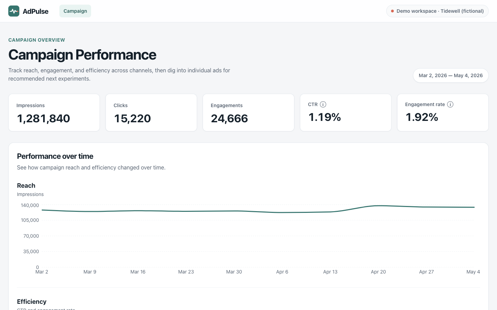
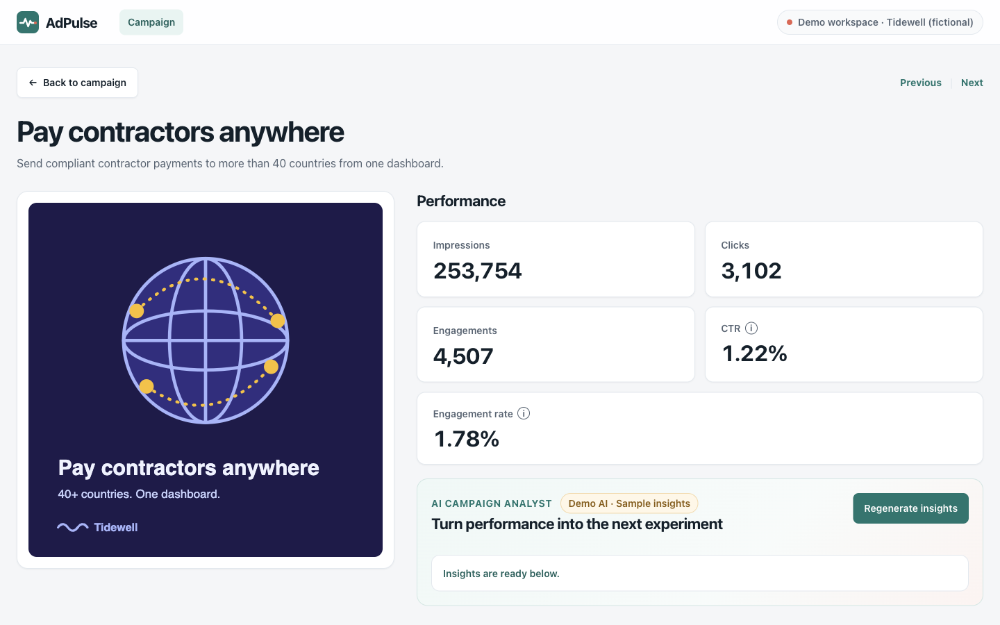
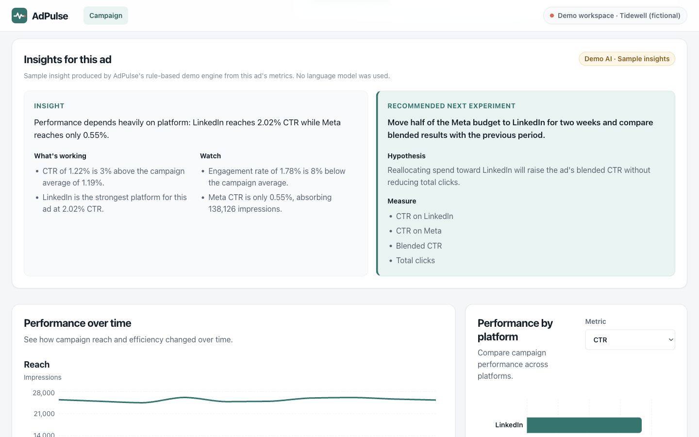

# AdPulse — AI-Powered Campaign Analytics

AdPulse is a full-stack campaign analytics dashboard. It turns raw ad delivery data into campaign and per-ad performance views, then adds an AI insights layer that explains how an ad is performing and proposes the next experiment to run.

Analytics are calculated deterministically in application code. AI sits on top as a decision-support layer: it interprets those numbers but never produces them.

> **All data in this project is fictional.** "Tidewell" is an invented payroll software brand, and every ad, metric and comment was generated by [`backend/scripts/generate_demo_data.py`](backend/scripts/generate_demo_data.py). By default, insights come from a rule-based demo engine, not a language model, and the UI labels them that way.



| Ad detail | Demo AI insights |
| --- | --- |
|  |  |

## Features

**Campaign dashboard**

- Campaign totals for impressions, clicks, engagements, CTR and engagement rate
- Weekly reach, CTR and engagement trends
- Platform breakdown (LinkedIn, Google, Meta) with a metric switcher
- Ad overview cards linking to each ad

**Ad deep dive**

- Creative and copy, ad-level metrics, timeline and platform breakdown
- Audience comments
- Previous/next navigation between ads

**AI insights**

- On-demand insights for each ad: a summary, strengths and risks, plus a separate *recommended next experiment* with a hypothesis and metrics to measure
- Two interchangeable providers behind one API contract:
  - **Demo AI** (default) is deterministic, rule-based, free and offline.
  - **Live AI** uses OpenAI structured outputs. It is opt-in and the key stays on the backend.
- Every response states which provider produced it, and the UI shows a matching badge ("Demo AI · Sample insights" or "Live AI · *model*").

**Quality of life**

- Responsive layout, loading skeletons, empty states and retryable error states
- Keyboard and screen-reader support: a skip link, visible focus styles, ARIA live regions and reduced-motion handling

## Tech stack

| Layer | Tools |
| --- | --- |
| Frontend | React 19, TypeScript, Vite, React Router, TanStack Query, Recharts, Sass |
| Backend | Python 3.12, FastAPI, Pydantic v2, pydantic-settings, OpenAI Python SDK |
| Testing | pytest, Vitest, React Testing Library |
| Quality | Ruff, mypy (strict), ESLint |
| Infrastructure | Docker, Docker Compose, Nginx, GitHub Actions |

## Architecture

```text
Browser ── React SPA (Vite build served by Nginx)
              │  /api/v1
              ▼
          FastAPI backend
              ├── Routes        HTTP boundaries and response models
              ├── Services      metric calculations, aggregation, insights
              │     └── insights/
              │           ├── DemoInsightsProvider    (default, no network)
              │           └── OpenAIInsightsProvider  (AI_PROVIDER=openai)
              └── Repositories  load and validate CSV data
                    └── backend/data/*.csv
```

- **Layered backend.** Routes handle HTTP concerns, services own the calculations, and repositories isolate the data source. You could swap the CSV files for a database or ad-platform API without touching the analytics logic.
- **Provider pattern for AI.** Both providers implement the same `InsightsProvider` protocol and return the same `AdInsightsResponse` schema. A factory picks one from configuration and FastAPI injects it, so switching providers needs no frontend changes.
- **Server state on the frontend.** TanStack Query handles data fetching and caching, and UI state stays local to the components that own it. No global store is needed.

### Project structure

```text
├── .github/workflows/      backend, frontend and Docker CI
├── backend/
│   ├── app/
│   │   ├── api/            routes and router
│   │   ├── core/           settings and exceptions
│   │   ├── models/         domain models
│   │   ├── repositories/   CSV loading and validation
│   │   ├── schemas/        API and AI schemas
│   │   └── services/       metrics, campaign/ad services, insights/
│   ├── data/               generated demo CSVs
│   ├── scripts/            demo data generator
│   └── tests/
├── frontend/
│   ├── public/ads/         original SVG ad creatives
│   └── src/                api, components, hooks, pages, types, utils
├── docs/screenshots/
├── .env.example
└── docker-compose.yml
```

## Getting started

### Run with Docker Compose

Requires Docker with Compose v2.

```bash
cp .env.example .env
docker compose up --build
```

| Service | URL |
| --- | --- |
| App | http://localhost:8080 |
| API | http://localhost:8000/api/v1 |
| Swagger UI | http://localhost:8000/docs |

Stop the services with `docker compose down`.

### Run locally

Requires Python 3.12+ and Node.js 22+.

**Backend**, from `backend/`:

```bash
python -m venv .venv
source .venv/bin/activate
pip install -r requirements.txt -r requirements-dev.txt
python -m uvicorn app.main:app --reload
```

**Frontend**, from `frontend/`:

```bash
cp .env.example .env
npm ci
npm run dev
```

Then open http://localhost:5173.

## Demo AI vs Live AI

| | Demo AI (default) | Live AI |
| --- | --- | --- |
| Enabled by | `AI_PROVIDER=demo` or unset | `AI_PROVIDER=openai` **and** `OPENAI_API_KEY` |
| External calls | None | OpenAI Responses API |
| Cost | Free | Billed to your OpenAI account |
| Output | Deterministic for the same data | Varies per request |
| UI label | "Demo AI · Sample insights" | "Live AI · *model name*" |

**How the demo engine works.** `DemoInsightsProvider` extracts signals from the ad's real metrics:

- CTR and engagement rate relative to campaign benchmarks
- the trend between the first and second half of the delivery period
- the gap between the best and worst platform
- the number of weeks with data

It classifies the ad into one of several patterns:

- outperforming or underperforming
- declining or recovering
- platform gap
- engagement without clicks
- limited data
- on benchmark

It then writes an insight and an experiment that cite the actual numbers. Each of the seven bundled ads was designed to show a different pattern, so every ad produces a different insight. The output is always labelled as a sample, and no language model is involved.

**How live mode works.** `OpenAIInsightsProvider` sends the ad's metrics, timeline, platform breakdown and comments, along with the campaign benchmarks, to OpenAI. It asks for a response matching the `AiCampaignInsight` Pydantic schema and validates what comes back. Requests have a timeout and are not retried.

**Failures.** If `AI_PROVIDER=openai` is set without a key, or the OpenAI call fails, the insights endpoint returns `503` with a generic message. The error type and status are logged, but the key and the provider's error body are not. The app does not quietly fall back to demo output, so demo results are never presented as live ones. The rest of the dashboard keeps working.

Check the active provider at any time with `GET /api/v1/insights/provider`.

## Environment variables

Backend settings are read from the root `.env`. See [`.env.example`](.env.example).

| Variable | Default | Purpose |
| --- | --- | --- |
| `APP_ENV` | `development` | Environment name |
| `API_V1_PREFIX` | `/api/v1` | API route prefix |
| `CORS_ORIGINS` | `http://localhost:5173` | Allowed browser origin (Compose sets `http://localhost:8080`) |
| `AI_PROVIDER` | `demo` | `demo` or `openai` |
| `OPENAI_API_KEY` | *(empty)* | Required only when `AI_PROVIDER=openai` |
| `OPENAI_MODEL` | `gpt-4o-mini` | Model used in live mode |
| `OPENAI_TIMEOUT_SECONDS` | `30` | Timeout for each OpenAI request |

The frontend uses one build-time variable, `VITE_API_BASE_URL`, set in `frontend/.env`. Never put API keys in frontend variables, because anything prefixed `VITE_` ends up in the browser bundle.

## API

| Method | Endpoint | Description |
| --- | --- | --- |
| `GET` | `/api/v1/health` | Health check |
| `GET` | `/api/v1/campaign` | Campaign summary, timeline and platform breakdown |
| `GET` | `/api/v1/ads` | Ads with performance metrics |
| `GET` | `/api/v1/ads/{ad_id}` | Full analytics for one ad |
| `POST` | `/api/v1/ads/{ad_id}/insights` | Generate insights (`provider` and `model` show where they came from) |
| `GET` | `/api/v1/insights/provider` | Active insights provider |

## Demo data

The files in `backend/data/` are generated by a seeded script, so the same input always produces the same output:

```bash
cd backend && python scripts/generate_demo_data.py
```

The script models seven ads across ten weeks and three platforms, with deliberate patterns such as declining CTR, recovery, platform gaps and a late launch. It enforces consistent metrics (`clicks ≤ engagements ≤ impressions`, one row per week, ad and platform). CI regenerates the data and fails if the result differs from the committed files.

## Testing and CI

```bash
# backend/
python -m ruff check . && python -m ruff format --check .
python -m mypy app tests scripts
python -m pytest

# frontend/
npm run lint
npm run test
npm run build
```

- **Backend tests** cover metric calculations, CSV loading and validation, aggregate totals checked against the raw data, API contracts, every demo insight pattern, provider selection, and OpenAI failures (including checks that the key never appears in errors or logs).
- **Frontend tests** cover pages, charts, empty and error states, and the insights UI for both demo and live responses.

GitHub Actions runs three workflows on pushes and pull requests to `main`:

- **Backend CI:** Ruff, mypy, pytest and the data reproducibility check
- **Frontend CI:** ESLint, Vitest and the production build
- **Docker CI:** `docker compose build`

## Technical decisions

- **Deterministic analytics first.** CTR, engagement rate and aggregations are computed and tested in Python. The AI layer only interprets them, which keeps the numbers reproducible and independent of the model.
- **A demo provider as the default.** Anyone can clone and run the full experience without an API key or any cost. Results are reproducible in tests and screenshots, and the labelling keeps it honest.
- **Explicit opt-in for live AI.** Live calls happen only when `AI_PROVIDER=openai` is set. A key sitting in `.env` is not enough to trigger them.
- **User-triggered generation.** Insights are generated on request, not on page load. This keeps usage predictable and cached per ad for the session.
- **A CSV data layer.** The dataset is small and static, so a database would add infrastructure without adding value. The repository layer keeps that choice reversible.

## Limitations

- Only one campaign is modelled, and the data is static and synthetic.
- Demo insights rely on threshold rules. They are illustrative, not statistically rigorous; for example, there are no significance tests and no spend or conversion data.
- Live insights depend on the quality of the model's output and should be reviewed before anyone acts on them.
- There is no authentication or multi-tenancy. Add both before deploying with real data.

## Future ideas

- Multiple campaigns, date-range filters and spend or conversion metrics (CPC, CPA, ROAS)
- Live integrations with ad-platform APIs and persistent storage
- An experiment tracker that turns recommendations into measurable tests with outcomes
- Additional providers (local models, other LLM APIs) behind the same interface
- Agentic workflows that propose and, with approval, run campaign changes

## License

No license has been chosen yet. Until one is added, all rights are reserved.
